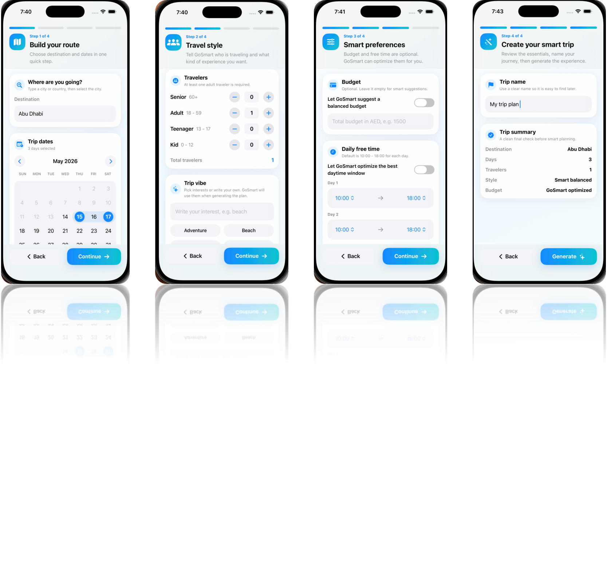
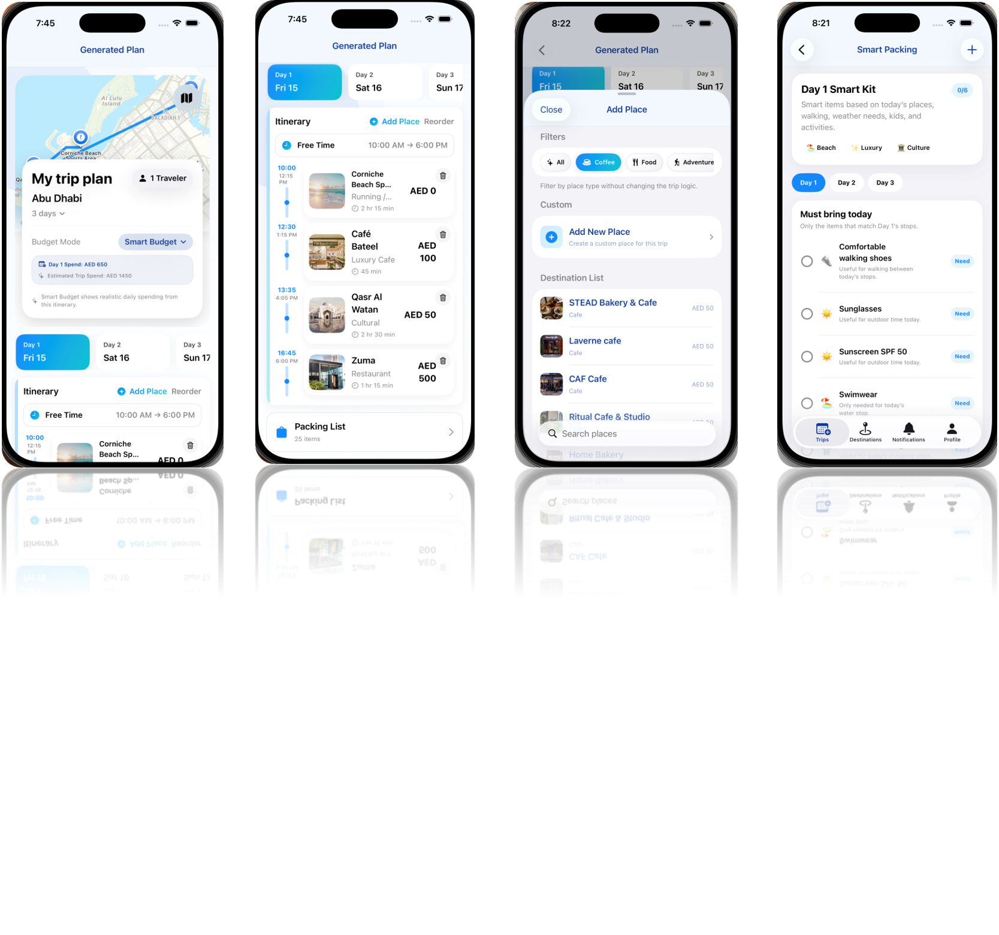

# GoSmart — Travel Planning App

GoSmart is an iOS travel-planning application developed as a collaborative capstone project at Higher Colleges of Technology.

It helps users turn their travel preferences into personalized daily itineraries, with destination browsing, map views, and packing suggestions.

## Main Features

- **Step-by-step trip creation:** Choose a destination, travel dates, number of travelers, and interests.
- **Flexible preferences:** Set a budget and daily available time, or use the app’s suggested options.
- **Personalized itineraries:** Generate daily schedules that consider activity duration and estimated travel time.
- **Plan customization:** Add, remove, and reorder places within a trip.
- **Map views:** View planned destinations on a map.
- **Packing lists:** Review suggested items and track packing progress.
- **User and admin features:** Support guest browsing, registered users, notifications, and administrator review of destination requests.

## Technologies Used

- **Swift** — Programming language
- **SwiftUI** — User interface development
- **Xcode** — Development environment
- **Firebase Authentication** — User authentication
- **Cloud Firestore** — Data storage
- **MapKit** — Maps

## Team Collaboration

This was a group project. All team members, including me, contributed to planning, interface design, development, and testing.

This portfolio showcase presents our shared work and my experience as a member of the team.

## App Screenshots

### Trip Creation
A four-step flow covering destination and dates, travelers and interests, budget and available time, and a final trip summary.

### Generated Plan & Smart Packing
An overview of the generated trip, daily itinerary, place selection, and packing checklist.

## About This Repository

This repository showcases the project through documentation and screenshots. Source code, Firebase configuration, and account credentials are not included.

GoSmart is an academic prototype. Travel times and costs are estimates.
